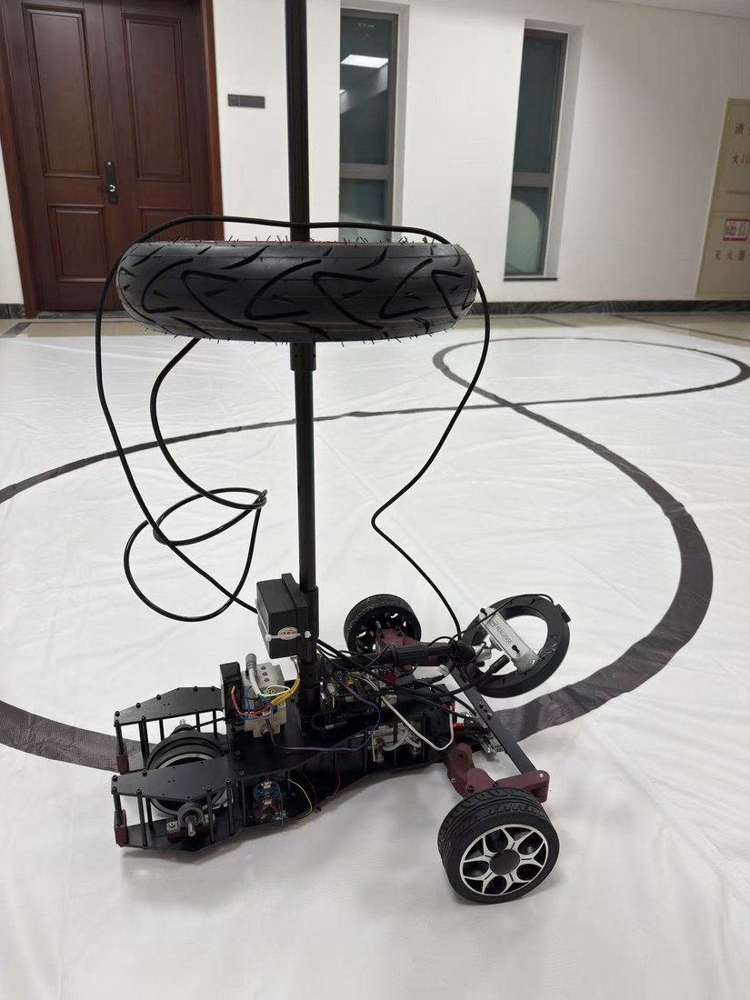
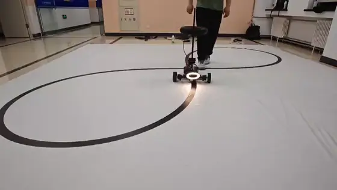
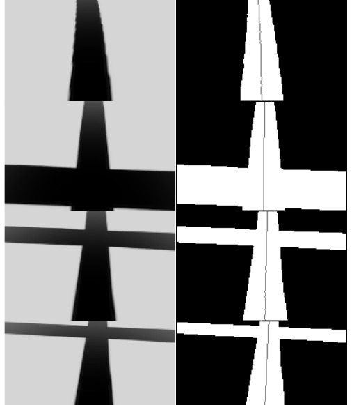
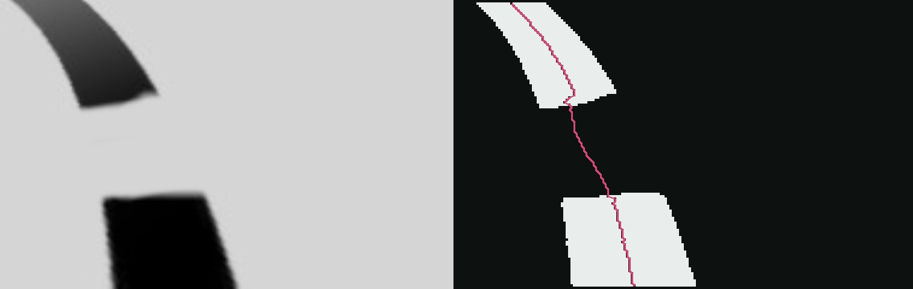
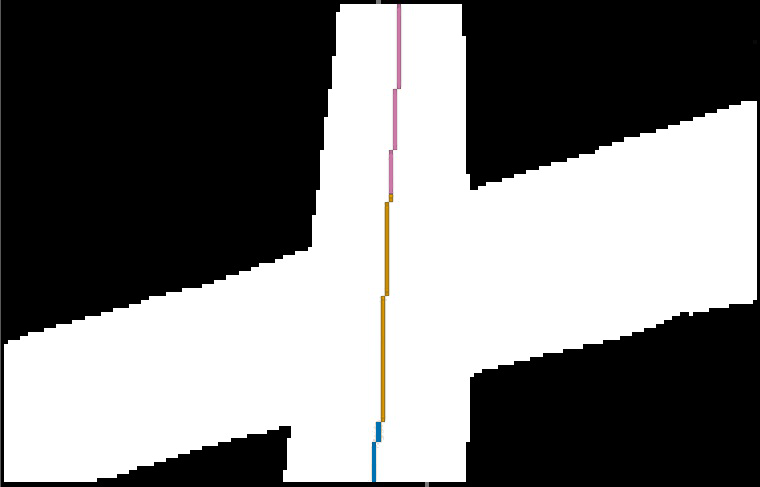
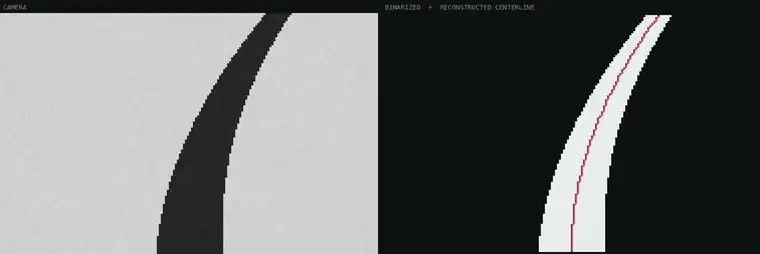
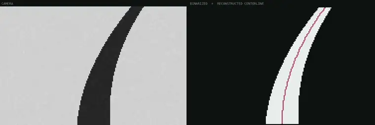
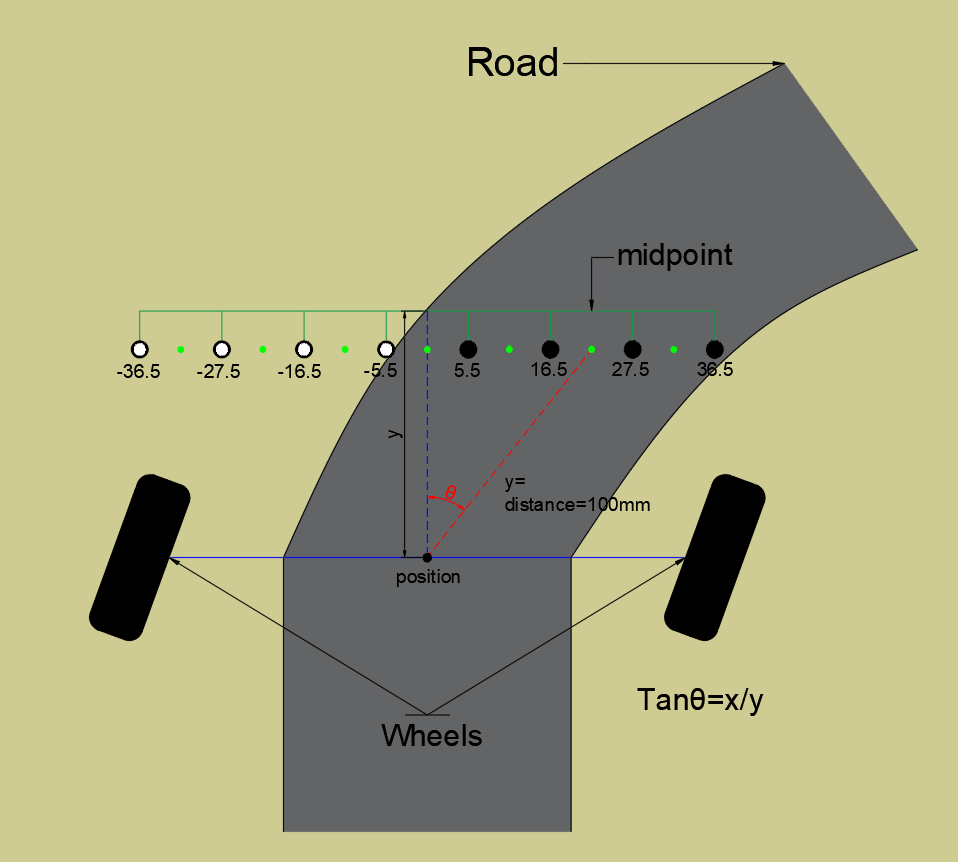
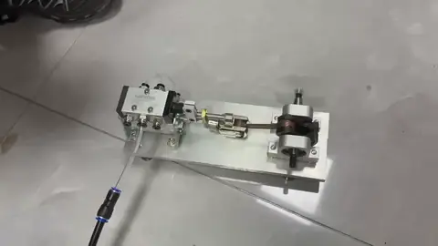

# 压缩空气循迹小车 —— 赛道中心线重建与双传感器融合

[English](README.md) | **中文**

一辆只靠一罐压缩空气驱动的循迹小车。本仓库是它的感知代码：一条摄像头流水线，**在车道"消失"的地方（十字路口、磨损的线）把中心线补出来**；一根经 I²C 读取的 8 路灰度传感器；以及一条规则，决定两个转角估计里该信哪一个。纯 C/C++，跑在嵌入式 Linux 板（RDK X5）的 CPU 上，不用 GPU，**188 × 120 分辨率下 45 fps**。

<table>
  <tr>
    <td width="36%"></td>
    <td width="64%"></td>
  </tr>
</table>
<p align="center"><sub>左：小车本体 —— 立柱上的轮胎就是气罐 · 右：在测试赛道上循迹（1.5 倍速）</sub></p>

> **项目背景** —— MAE 106 机械系统实验（Mechanical Systems Laboratory），大连理工–UCI 合作项目，7 人团队，2025 年 2 月 – 5 月。我负责的是**气动动力系统**和**本仓库的感知部分**。
> 算法已整理成独立作者期刊论文发表：
> Tian Xia, *A Bidirectional 8-Neighborhood Border Tracking and Kalman-Based Centerline Reconstruction Method for Line-Following Robots*, Applied and Computational Engineering 167(1), 122–129, 2025.
> [doi:10.54254/2755-2721/2025.GL25448](https://doi.org/10.54254/2755-2721/2025.GL25448) ·
> 带视频的完整介绍：[krisxia.com/linefollower](https://krisxia.com/linefollower.html)

## 结果

论文中报告的结果，同一组 100 张真实帧，188 × 120：

| 指标 | 单向追踪 | 本方法 |
|---|---|---|
| 断点恢复率（误差 5 px 以内） | 48% | **94%** |
| 平均位置误差 | 16.3 px | **2.1 px** |
| 中心线平滑度（σ） | 6.7 | **1.6** |
| 吞吐量（纯 CPU） | — | **45 fps** |

对照组是我为了比较而自己实现的单向追踪器 —— 这不是和已发表系统的横向评测。

## 要解决的问题

转角取画面**最底下 15 行**中心线偏移的均值，每像素约 0.4° —— 小车转向只看这 15 个像素。常规的边界追踪从画面底部往上走，**遇到第一个断口就停下**。如果断口压在画面底部，追踪根本起不来，中心线退化成画面正中一条竖直线；转角计算会把它读成"笔直的路"—— 而这恰恰发生在车正处于断开路段的时候。

<p align="center">
  
  &nbsp;
  
</p>
<p align="center"><sub>左：十字路口（第一行是无断口的对照）。右：车道磨穿成两块 —— 中心线被接过了空白。</sub></p>

## 工作原理

```
摄像头帧 ─► 灰度 → 5×5 高斯滤波 → 直方图均衡 → 缩放到 188×120
        ─► Otsu 阈值（+ 可调偏置）                                 ┐
        ─► 自下而上边界追踪   ──► 在第 y₁ 行断掉                   │  src/image.c
        ─► 自上而下边界追踪   ──► 在第 y₂ 行断掉                   │
        ─► 断口两侧分别最小二乘拟合，跨缺口平滑过渡               │
        ─► 对重建段跑 2 状态卡尔曼 → 合并成最终中心线              ┘
        ─► 摄像头转角 θ_cam = 底部 15 行平均偏移 × 0.4°/px
8 路灰度传感器（I²C）─► θ_gray = arctan(偏移 / 100 mm)            ┐  src/main.cpp
融合：|θ_cam − θ_gray| < 10° → 取平均；否则信变化更小的那个        ┘
```

1. **二值化。** Otsu 法，再在它算出的阈值上加一个可手调的偏置。偏置调高能把断缝合上，调低车道更锐利但噪声会进来 —— 换一块新地面时，主要就靠这一个旋钮适配。
2. **两头追踪。** 八邻域边界跟踪（8-neighborhood border following）和 Otsu 都是现成技术；本仓库加的是把追踪跑两遍 —— 先自下而上，再自上而下（旋转方向镜像）。每一趟都从自己那一侧一直走到缺陷处才停，所以 `y₁` 和 `y₂` 之间那一段正好就是需要重建的部分。判断断口的依据是相邻行跳变：往上走超过 5 px、往下走超过 3 px。如果起始行找不到黑白跳变，起点搜索会往画面中间最多回退 30 行，而不是直接放弃。
3. **从两端补线。** 每条边界按 `x = k·y + b` 拟合（把 x 写成行号的函数，车道接近竖直时也不会病态），用 `y₂` 之上 10 行、`y₁` 之下 10 行的数据。两条拟合线都外推穿过缺口，按 `t²(3 − 2t)` 权重交叉过渡，交接发生在中段。如果两端都凑不出两行可用数据，就跳过不补，而不是凭空编一条。
4. **平滑与合并。** 一个 2 状态卡尔曼滤波（位置和斜率，行号充当"时间"）沿重建段走一遍；然后三段合并成一条中心线。没有测量值的行标为 `-1`。

<p align="center">
  
</p>
<p align="center"><sub><b>蓝</b>（底部）：自下而上追踪 · <b>橙</b>（中段）：跨越路口的重建段 · <b>紫红</b>（顶部）：自上而下追踪</sub></p>

**精度到底是谁贡献的** —— 在合成用例上做的两组消融（6 个缺口用例、共 130 个补线行）：

| 变体 | 平均误差 | 最差行 |
|---|---|---|
| 只用上端拟合往下外推 | 3.61 px | 13 px |
| 两端拟合 + 平滑过渡（现行版本） | **2.09 px** | **5 px** |
| 两端拟合，关掉卡尔曼 | 2.05 px | — |

起作用的是"第二个锚点"。卡尔曼这一级在这里几乎没有贡献：它要平滑的那一段本身已经是两条直线的解析混合，而它本来要滤掉的测量噪声在上一级就已经去掉了。

<table>
  <tr>
    <td></td>
  </tr>
  <tr>
    <td></td>
  </tr>
</table>
<p align="center"><sub>合成帧送进真实的 C 代码 —— 左边是输入，右边是它的判断。上：短缺口。下：十字路口。</sub></p>

### 两个传感器，该信哪一个



车头装一根 8 路灰度传感器，经 I²C 读取。读数比阈值（170）暗的探头就是压在线上的；它们的平均位置 `x`，加上到转向中心固定的 100 mm，得到 `θ_gray = arctan(x / 100 mm)` —— 用反正切而不是比例系数，因为量的是车上两点之间一条真实连线的角度。

于是同一个角度有了两个独立估计，而它们并不总是一致。源码里还留着（已注释掉的）固定加权 `0.7 × 摄像头 + 0.3 × 灰度`：一个传感器出错时，会按事先定好的权重把另一个也拖偏。最终采用的是按"分歧"来判断：

- 两者相差 **10°** 以内 → 大概都没问题，取平均；
- 相差更大 → 其中一个被骗了（十字路口、反光、磨损的线），取**与上一帧相比变化更小**的那个。

<br clear="right">

## 小车本体



- **发动机** —— 缸径 20 mm × 行程 45 mm 的气缸带动曲柄；一个两位五通阀与活塞杆连在一起，活塞自己走到行程末端时就把气路换向。曲柄经 2GT 同步带 1:1 驱动车轮 —— 一个循环，车轮转一圈。
- **气罐** —— 一只 5 L 轮胎，充到 2 bar。从 2 bar 膨胀到 0.3 bar、配 10 cm 车轮，理论可跑 72.67 m；实测**一次充气跑了 62.3 m（86%）**。
- **底盘** —— 用一根居中立柱托住气罐而不是四根；平行四边形前轮转向，由底盘中央的舵机驱动；碳纤维底板大面积开孔减重 —— 能量预算固定，每一克都是距离。

<br clear="right">

## 仓库结构

```
src/
  main.cpp       摄像头采集与预处理、I²C 读灰度传感器、传感器融合、实时显示
  image.c/.h     二值化、双向追踪、断口检测、补线、卡尔曼、合并
tests/           合成回归测试（synth.py → runner.c → bench.py），不依赖 OpenCV
fps_check/       列出摄像头支持的全部分辨率和帧率（V4L2）
reso_filter/     同上，只列某一宽高比
pics/            开发期间用的车道样张
docs/media/      本 README 用到的图片和动图
```

## 编译运行

在车上（Linux、OpenCV 4；灰度传感器在 `/dev/i2c-0`、地址 `0x4C`，两者都在 `src/main.cpp` 开头定义）：

```bash
cd src
make          # g++ 编译 main.cpp image.c，编译参数来自 pkg-config opencv4
./main        # 每帧打印 CAM / GRAY / FUSED 三个角度和帧率；按 ESC 退出
```

`center_line_final[y]` 可能是 `-1`，表示那一行没有测量值 —— 当作 x 坐标用之前先判断。

## 测试

真实素材只覆盖几段连续弯道，也没有标准答案，所以回归测试改为逐行"画"车道：画车道时用的那条中心线*就是*答案，重建误差可以精确算出来。

```bash
cd tests && make && python3 bench.py
```

1. **重建精度** —— 在连续车道上人为挖掉一段，把补出来的中心线和真值比。算法标成 `-1` 的行计入覆盖率，不算作误差。
2. **序列稳定性** —— 六个场景（直道、弯道、十字路口、短缺口、长缺口、S 弯）各跑 48 帧，统计中心线横向跳变的帧数。静态图抓不到这类问题；之前两个真实的 bug（缺口压在画面底部时整幅输出退化成一条直线、画面顶部把默认值当中心线画出来）都是逐帧扫才发现的。

当前基线：平均重建误差 **2.1 px**，异常帧 4 帧，全部在十字路口用例的开头 —— 那几帧横杠占满整幅画面宽度，本来就没有有意义的"车道中心"。
